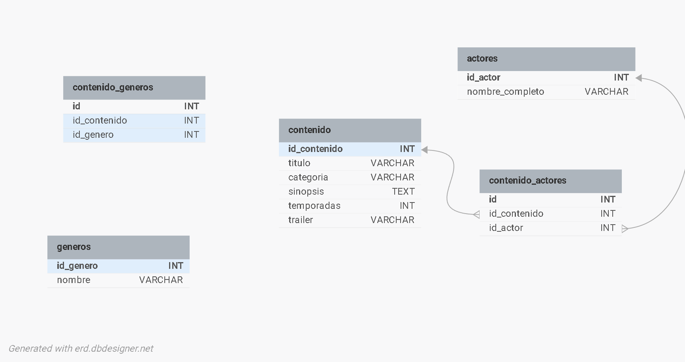

# Trailerflix API

**URL base:** `http://localhost:3008/`

## Sumario

- [Resumen del proyecto](#resumen-del-proyecto)
- [Origen del set de datos](#origen-del-set-de-datos)
- [Objetivo](#objetivo)
- [Modelo relacional](#modelo-relacional)
- [Tecnologías](#tecnologías)
- [Configuración y ejecución](#configuración-y-ejecución)
- [Endpoints](#endpoints)
- [Ejemplos de uso](#ejemplos-de-uso)
- [Códigos de respuesta](#códigos-de-respuesta)

## Resumen del proyecto

Trailerflix es una API REST para consultar y administrar un catálogo de películas y series. Expone búsquedas, filtros, estadísticas y operaciones CRUD sobre los contenidos.

## Origen del set de datos

El set original fue entregado por la cátedra en formato JSON e incluía películas y series; luego se transformó y se cargó en MySQL mediante SQL.

## Objetivo

El objetivo es organizar el catálogo en un modelo relacional y ofrecer endpoints que permitan consultarlo y mantener sus contenidos, géneros y actores.

## Modelo relacional

`contenido` guarda los datos principales; `generos` y `actores` se relacionan con el contenido mediante las tablas intermedias `contenido_generos` y `contenido_actores`. La vista SQL `vista_catalogo` combina esos datos para las consultas del catálogo. El diagrama se encuentra en [`trailerfix.png`](./trailerfix.png).



## Tecnologías

El servidor utiliza Node.js y Express; Sequelize gestiona el acceso a MySQL y el mapeo entre las tablas relacionales y los modelos de JavaScript.

## Configuración y ejecución

Requisitos: Node.js, npm y un servidor MySQL. Ejecuta el script [`trailerfix.sql`](./trailerfix.sql) en MySQL para crear la base `trailerflix`, sus tablas, cargar los datos y crear la vista `vista_catalogo` antes de iniciar la API.

Crea un archivo `.env` en la raíz del proyecto con tus datos locales. No uses credenciales reales en este ejemplo:

```env
PORT=3008
DB_NAME=trailerflix
DB_USER=tu_usuario_mysql
DB_PASSWORD=tu_contrasena_mysql
DB_HOST=localhost
DB_DIALECT=mysql
```

Instala las dependencias e inicia el servidor:

```powershell
npm install
npm start
```

Al iniciar, la API queda disponible en `http://localhost:3008/`.

## Endpoints

| Método | Ruta | Descripción |
|---|---|---|
| GET | `/` | Mensaje de bienvenida de la API. |
| GET | `/catalogo/resumen` | Cantidad total de títulos, series, películas, géneros y actores. |
| GET | `/generos` | Lista los géneros disponibles. |
| GET | `/actores` | Lista los actores disponibles. |
| GET | `/catalogo` | Consulta el catálogo; permite filtros, orden y paginación. |
| GET | `/titulo/:title` | Busca títulos que coincidan parcialmente con el texto indicado. |
| GET | `/categoria/:cat` | Filtra el catálogo por categoría; admite búsqueda con o sin tilde. |
| GET | `/reparto/:act` | Busca por actor o actriz y devuelve título y reparto. |
| GET | `/trailer/:id` | Consulta el tráiler de un contenido o informa si no está disponible. |
| GET | `/contenido` | Lista los contenidos de la tabla principal. |
| GET | `/contenido/:id` | Consulta un contenido por su ID. |
| POST | `/contenido` | Crea un contenido y, opcionalmente, lo asocia con géneros y actores. |
| PUT | `/contenido/:id` | Reemplaza los datos de un contenido existente. |
| DELETE | `/contenido/:id` | Elimina un contenido y sus asociaciones. |

En `GET /catalogo`, los parámetros opcionales son `categoria`, `titulo`, `genero`, `order` (`id` o `titulo`), `orden` (`ASC` o `DESC`), `limit` y `offset`. Si un filtro de categoría, título o género no encuentra resultados, la API responde `404`.

## Ejemplos de uso

En Postman o Thunder Client, selecciona el método indicado y pega la URL en el campo de dirección. Para `POST` y `PUT`, configura el cuerpo como **Body → raw → JSON**. Reemplaza los valores de ejemplo por datos existentes cuando corresponda.

### GET

```text
GET  http://localhost:3008/
GET  http://localhost:3008/catalogo/resumen
GET  http://localhost:3008/generos
GET  http://localhost:3008/actores
GET  http://localhost:3008/catalogo?categoria=Serie&genero=Drama&order=titulo&orden=ASC&limit=10&offset=0
GET  http://localhost:3008/titulo/NOMBRE%20PARCIAL
GET  http://localhost:3008/categoria/Pel%C3%ADcula
GET  http://localhost:3008/reparto/NOMBRE%20DEL%20ACTOR
GET  http://localhost:3008/trailer/1
GET  http://localhost:3008/contenido
GET  http://localhost:3008/contenido/1
```

### POST `/contenido`

`temporadas`, `trailer`, `generos` y `actores` son opcionales. Para asociar géneros o actores, usa IDs existentes; puedes consultarlos en `GET /generos` y `GET /actores`.

**Método:** `POST`  
**URL:** `http://localhost:3008/contenido`  
**Header:** `Content-Type: application/json`  
**Body (raw → JSON):**

```json
{
  "titulo": "Serie de ejemplo",
  "categoria": "Serie",
  "sinopsis": "Descripción de ejemplo",
  "temporadas": 1,
  "trailer": null,
  "generos": [1],
  "actores": [1]
}
```

### PUT `/contenido/:id`

`titulo`, `categoria` y `sinopsis` son obligatorios. Si omites `temporadas` o `trailer`, se guardan como `null`; una película debe tener `temporadas: null`.

**Método:** `PUT`  
**URL:** `http://localhost:3008/contenido/1`  
**Header:** `Content-Type: application/json`  
**Body (raw → JSON):**

```json
{
  "titulo": "Película actualizada",
  "categoria": "Película",
  "sinopsis": "Descripción actualizada",
  "temporadas": null,
  "trailer": null
}
```

### DELETE `/contenido/:id`

Este ejemplo elimina el contenido con ID `1` y sus asociaciones. Usa un ID de prueba si no quieres borrar un registro existente.

**Método:** `DELETE`  
**URL:** `http://localhost:3008/contenido/1`

## Códigos de respuesta

- `200`: consulta o modificación completada.
- `201`: contenido creado.
- `400`: entrada o parámetros inválidos.
- `404`: ruta, contenido o resultados de búsqueda no encontrados.
- `500`: error interno o de acceso a la base de datos.
